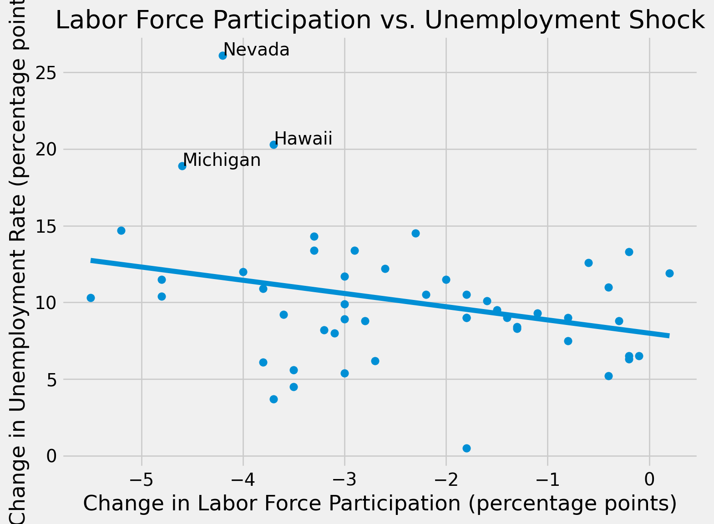

# COVID-19 Unemployment Shock Analysis

An analysis of how U.S. states' unemployment rates responded to the start of the COVID-19 pandemic, using Python and public data from the Federal Reserve Bank of St. Louis (FRED).

## Question
Did states with larger drops in labor-force participation see larger unemployment spikes in spring 2020, and did harder-hit states recover more slowly?

## Short answer
The link between participation and unemployment was weak and sensitive to outliers, especially Nevada. The most consistent pattern was that larger initial shocks were modestly associated with slower recovery.

## Data
Source: [FRED API](https://fred.stlouisfed.org/docs/api/fred/), monthly, seasonally adjusted.
- State unemployment rates (series like `NCUR`)
- State labor-force participation rates (series `LBSSA` + state code)
- State leisure and hospitality employment (`LEIH`) and total nonfarm employment (`NA`) series, used to measure industry exposure

Sample: 50 states (DC excluded). The shock is measured as April 2020 minus February 2020.

## Methods
- OLS regression of the unemployment shock on the change in labor-force participation, with heteroskedasticity-robust (HC3) standard errors
- Outlier checks: Cook's distance and re-estimating without Nevada and Hawaii
- Rank-based check: Spearman correlation
- Industry exposure: added each state's pre-COVID leisure and hospitality share of jobs
- Recovery: correlation between the initial shock and the gap to pre-COVID unemployment in December 2021

## Key findings
| Test | Result |
|---|---|
| Participation → shock (50 states) | coef -0.86, p = 0.037, R² = 0.093 |
| Excluding Nevada and Hawaii | coef -0.49, p = 0.143, R² = 0.050 |
| Spearman rank correlation | rho = -0.26, p = 0.073 |
| Hospitality share added (all states) | coef +0.84, p = 0.046, R² = 0.333 |
| Hospitality share excluding Nevada | coef +0.45, SE 0.86 (not significant) |
| Shock vs. recovery (Dec 2021 gap) | r = 0.35, p = 0.014 (r = 0.25 without NV, HI) |

- Nevada is highly influential (Cook's distance 0.34 vs. a 0.08 rule-of-thumb threshold). The apparent participation and hospitality effects depend heavily on it.
- States still furthest above their pre-COVID unemployment rate in December 2021: New Jersey, Connecticut, New York, Illinois, California.

## Limitations
- Results show association, not causation.
- State unemployment figures are model-based estimates, and April 2020 data had well-documented classification problems.
- Hospitality share uses a single pre-COVID month, and the sample is only 50 observations, so one extreme state can dominate.
